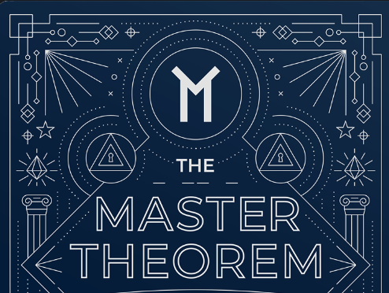

I'm almost halfway through graduate school!  For each course I've tried to distill and retain at least one concept or idea that was either particularly novel or important.  For CS581 Programming Languages that was the concept of programming language grammar specifications like the one for [Python](https://docs.python.org/3/reference/grammar.html) that detail how language parsers contruct parse trees during the first phases of compilation. In CS572 Computer Architecture I learned that computer architectures balance multiple tradeoffs.  For example, a computer architecture might have a high clock rate (i.e. 4GHz) but that might be counterbalanced by a high CPI (clock Cycles Per Instruction) due to the complexity of the instructions necessary to accomplish that clock rate, or by a high instruction count.  The classic example of the latter two tradeoffs would be CISC (Complex Instruction Set Computers) vs. RISC (Reduced Instruction Set Computers). CS565 Human Computer Interfaces taught me general design principles as well as gave me hands-on experience creating designs in Figma, a UX (User Experience) tool designers at my current work regularly use. In Digital Forensics (CS573) I learned that forensics was simply the application of any kind of science to legal investigations in order to develop evidence. As such, privacy laws are at least as important as the actual software used for digital forensic analysis, with the CFAA (Computer Fraud and Abuse Act), SCA (Stored Communications Act), ECPA (Electronic Communications Privacy Act) serving as the cornerstones upon which decades of jurisprudence has been built around.

Which brings me to my latest class, CS514, Algorithms. A fair amount of the course content had been covered in my undergraduate algorithms course.  Time complexity, graph theory, heaps, queues, dynamic programming, and NP-completeness were all review from undergraduate for me.  What I found novel, and particularly challenging, was the additional dephth that we were asked to go into.  For example, I learned how to mathematically prove the correctness of an algorithm, both through induction and by contradiction.

Perhaps the most memorable thing from CS514 for me however is the eponymous "Master Theorem". In my undergraduate algorithms and data structures courses I was expected to be able to derive the time and space complexity of iterative algorithms. Analysis of recursive algorithms was outside the scope of the course.  Technically any recursive algorithm can be converted to an iterative algorithm, and vice versa.  But the Master Theorem provides a means to calculate the time complexity of polynomially based recursive functions without the need to convert the underlying algorithm used.  

The Theorem itself is surprisingly straightforward.  The first part is to determine the recurrence relation of the algorithm.  For example, the following python code computes x to the nth power:

```python
def power2(x, n):
    if n == 0: return 1
    if n == 1: return x
    if n % 2 == 0: 
        return power2(x, n // 2) * power2(x, n // 2)
    else: 
        return power2(x, n // 2) * power2(x, n // 2) * x
```

The base cases of the recursive algorithm are just comparisons of n and run in a constant time of $T(n)=c_1$ when $0 ≤ n ≤ 1$.  The recursive case is $T(n) = 2T(n/2) + c_2$ when $n > 1$, assuming constant time complexity for the conditional comparisons and subsequent division and multiplication operations (that is, "$c_2$").  The "$2T$" comes from the fact that two recursive calls are triggered.  The "$n/2$" is because each recursive call operates on half of the original input. The entire recurrence relation is:

$T(n)=\left\{\begin{matrix}
 c_{1} & 0 \leq  n \leq  1 \\
 2T(n/2) + c_{2} & n > 1
\end{matrix}\right.
$

In the recursion relation we then determine the scalar for T, in this case 2 (from 2T), and the denominator of n, in this case also 2 (from n/2).  We assign these values to the variables a and b respectively then fit them into one of the cases below:

1. $f(n) = O({n}^{log_ba-ε})$ for some constant ε > 0.
2. $f(n) = \Theta ({n}^{log_ba})$.
3. $f(n) = \Omega({n}^{log_ba+ε})$ for some constant ε > 0.

Under case 1 f(n) is polynomially smaller than ${n}^{log_ba}$.  This means that in the recursion tree the cost is dominated by the leaves.  The time complexity for this case is $T(n) =\Theta ({n}^{log_ba})$.

Under case 2 f(n) is within a polylog factor of ${n}^{log_ba}$.  This means that in the recursion tree the leaves are balanced with the root.  The time complexity for this case is $T(n) =\Theta ({n}^{log_ba}lg(n))$.

Under case 3 f(n) is polynomially larger than ${n}^{log_ba}$. This means that in the recursion tree the cost is dominated by the root of the tree.  The time complexity for this case is $T(n) =\Theta(f(n))$.

Substituting 2 and 2 from the recursion relation above for the values a and b gives us ${n}^{log_22}$.  Using the [log change of base rule](https://www.cuemath.com/change-of-base-formula/) allows us to replace that exponent with ${n}^{ln2/ln2}$, which is pretty handy because anything divided by itself, including identical natural logs, is 1.  This gives us a final exponent of $n^{1}$, or just n.  That gives us a relation of $f(n)=\theta(n)$, or case two from above.  Because it's case two, we can safely conclude that the time complexity for our recursive power2 function is $T(n) =\Theta ({n}^{log_ba}lg(n))$ which can be simplified using the same log change of base rule as before to just $T(n) =\Theta (n \times lg(n))$.  

If our recursion relation was something else, say $ 4T(n/2) + c_{2}$ we would have 4 and 2 for a and b.  This would give us ${n}^{log_24}$, or ${n}^{ln4/ln2}$ which simplifies to ${n}^{2}$.  In order to make the exponents on the two sides match we now need to assign a value to ε to make them match.  For $f(n^{1}) = O({n}^{2-ε})$ we have to use $ε=1$ because 2-1 = 1, which is the exponent on the other side.  Because $ε>0$ we would now fall under case 1, which has a time complexity of $T(n) =\Theta ({n}^{log_ba})$.  Substituting a and b again simplifies the function to $T(n) =\Theta ({n}^{log_24})$, or just $\Theta ({n}^{2})$.

I found the Master Theorem to be perhaps the most fascinating part of my Algorithms graduate coursework.  It provides an intuitive method for calculating a recursive algorithm's time complexity that's only slightly more involved than calculating the time complexity of a iterative algorithm.  I hope you find it useful; I know I do.
